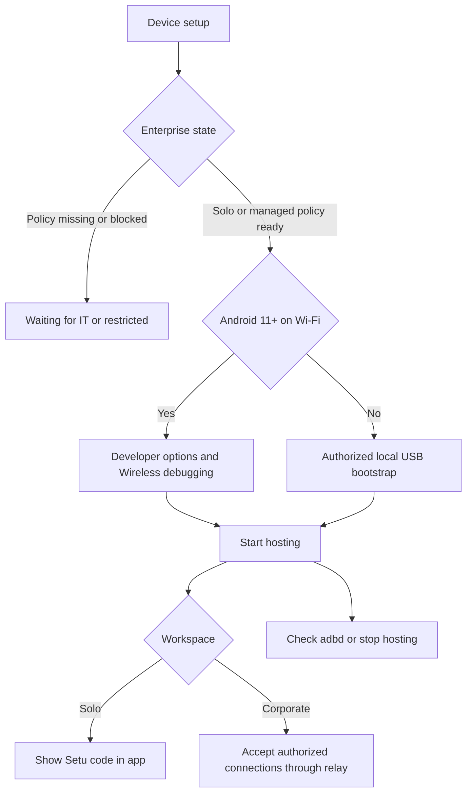

# Android screen inventory

**Selected layout** · Field's step-by-step setup inside the Relay bottom navigation pattern. The Device destination guides setup and hosting. Settings groups readiness and management. [Canonical journeys and acceptance tests](https://github.com/SumukhaK/Setu-Desktop/blob/main/docs/JOURNEYS.md)

```text
┌──────────────────────────────────────┐
│ Setu                  Workspace ···  │
│ Prepare ───── Host                   │
│ Device readiness                    │
│ ┌──────────────────────────────────┐ │
│ │ Detected setup path              │ │
│ │ Current check or recovery        │ │
│ │ Continue setup / Start hosting   │ │
│ └──────────────────────────────────┘ │
│ Hosting state and device ID          │
│ Solo code visible only in the app    │
│ Stop hosting                         │
├──────────────────────────────────────┤
│ Device                      Settings │
└──────────────────────────────────────┘
```

| ID | Screen or state | Data and primary action | Acceptance |
| --- | --- | --- | --- |
| A01 | Device home and mode | Start locally in Solo or show EMM-managed status. Mode selection cannot override managed policy. | P01, P07 |
| A02 | Setup branch | Use OS API level and Wi-Fi state. Android 11+ on Wi-Fi enters the Wireless debugging route. Android 10 or cellular-only enters USB fallback when policy permits. | P04 |
| A03 | Developer options and Wireless debugging | Use Settings and recheck on return. System pairing sheet provides the system code and temporary port separately from the Setu code. | P04, P05 |
| A04 | USB bootstrap | Guide authorized local USB setup and device-side endpoint check before unplugging. Explain reboots and restricted OEM environments. | P04 |
| A05 | Notification and battery readiness | Android 13+ permission and denial. Show standard battery settings and OEM paths for Xiaomi, Samsung and ColorOS where available. Include MIUI installation troubleshooting. | P04, P06 |
| A06 | Solo hosting | Show `Online`, device ID, and the current digits-only code generated by the agent. Keep **Stop hosting** available. | P01, P03, P10, P17 |
| A07 | Managed transition, waiting and blocked | Acknowledge the first enrollment transition, display missing config or restriction, and recover through IT. Managed hosting suppresses the pairing code. | P07, P11 |
| A08 | Hosting recovery and peer visibility | Show `adbd_unreachable` guidance for the selected path. Peer identity and path remain unknown until a supported, authenticated event provides them. | P10 |
| A09 | Foreground notification and settings | Show hosting state and a whole-host stop action. Use secret lock-screen visibility and omit pairing codes. | P06, P17 |


