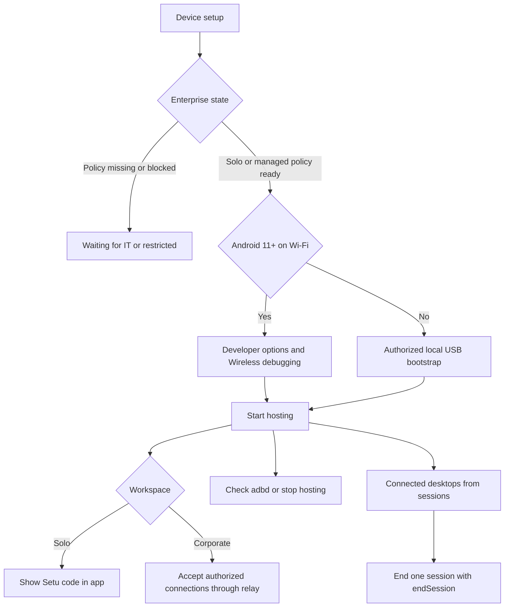

# Android screen inventory

**Selected layout** · Field's step-by-step setup inside the Relay bottom navigation pattern. The Device destination guides setup and hosting. Settings groups readiness and management. [Canonical journeys and acceptance tests](https://github.com/SumukhaK/Setu-Desktop/blob/main/docs/JOURNEYS.md) · [TDD tickets](TDD_TICKETS.md) · Baseline: **Setu-SDK v1.1.0** · [921aded](https://github.com/SumukhaK/Setu/commit/921aded)

```text
┌──────────────────────────────────────┐
│ Setu                  Workspace ···  │
│ Prepare ───── Host                   │
│ Device readiness                    │
│ ┌──────────────────────────────────┐ │
│ │ Detected setup path              │ │
│ │ Current check or recovery        │ │
│ │ Continue setup / Start hosting   │ │
│ └──────────────────────────────────┘ │
│ Hosting state and device ID          │
│ Solo code visible only in the app    │
│ Connected desktops · End             │
│ Stop hosting                         │
├──────────────────────────────────────┤
│ Device                      Settings │
└──────────────────────────────────────┘
```

| ID | Screen or state | Data and primary action | Acceptance |
| --- | --- | --- | --- |
| A01 | Device home and mode | Start locally in Solo or show EMM-managed status. Mode selection cannot override managed policy. | P01, P07 |
| A02 | Setup branch | Use OS API level and Wi-Fi state. Android 11+ on Wi-Fi enters the Wireless debugging route. Android 10 or cellular-only enters USB fallback when policy permits. | P04 |
| A03 | Developer options and Wireless debugging | Use Settings and recheck on return. Android's pairing dialog shows a six-digit system code and port, separate from the Setu code. The tester reads them to the developer, who submits the code and optional port on Desktop (`session.pair_adb`). This app never asks for or stores the system code. | P04, P05 |
| A04 | USB bootstrap | Guide authorized local USB setup and device-side endpoint check before unplugging. Explain reboots and restricted OEM environments. | P04 |
| A05 | Notification and battery readiness | Android 13+ permission and denial. Show standard battery settings and OEM paths for Xiaomi, Samsung and ColorOS where available. Include MIUI installation troubleshooting. | P04, P06 |
| A06 | Solo hosting | Show `ConnectionState.Online`, device ID, and the current digits-only code generated by the agent. `Reconnecting` means the agent process is restarting (render `retryInMs = -1` without a countdown). Keep **Stop hosting** available. | P01, P03, P10, P17 |
| A07 | Managed transition, waiting and blocked | Acknowledge the first enrollment transition, display `PolicyMissing` or `Blocked`, and recover through IT. Managed hosting suppresses the pairing code. The SDK scopes `policy_json` to this device; never cache the unscoped JSON. | P07, P11 |
| A08 | Connected desktops and hosting recovery | List `SetuManager.sessions`: label shown under **Connected as (unverified)** (the SDK's `peerLabel` is the desktop's `--label`, else the corporate user, else `desktop-<key fingerprint>`), transport, path (`UP`, `DOWN`, `LOST`). **End** calls `endSession(id)` and observes the updated list. Other rows and hosting stay active. A compatible, intact path delivers terminal `peer_closed` to Desktop. Show `adbd_unreachable` guidance for the selected path. | P10, P14, P22 |
| A09 | Foreground notification and settings | Show hosting state, who is connected, and a whole-host stop action. Build wording with `SetuNotifications.content(state, sessions)`, post `publicText` in both variants, use `VISIBILITY_SECRET`, and never post `text`. | P06, P17 |

### Prototype session boundary

A native test host can provide `window.setuAndroidEndSession(id)` to forward **End** to `SetuManager.endSession(id)`. Deliver authoritative snapshots from `SetuManager.sessions` to `window.setuAndroidSessions(rows)`. Acceptance means the command was sent. The row remains until the SDK snapshot removes it. The standalone browser uses labeled fixtures.


